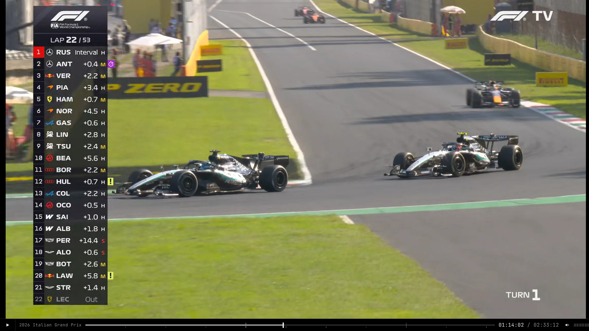
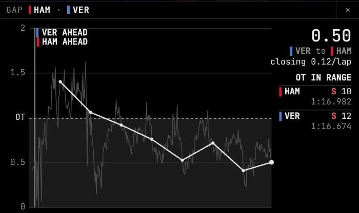
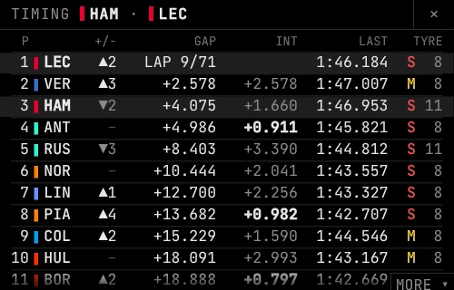
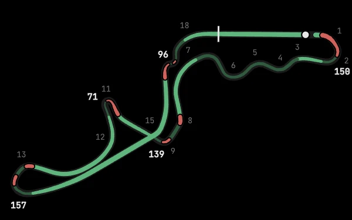
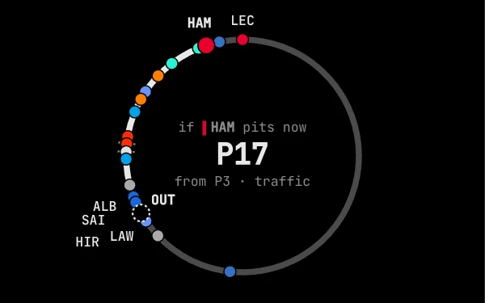

<p align="center"></p>

<h3 align="center">Your F1 viewer, with an AI TV director and race engineer. Just ask.</h3>

<p align="center">
  A fan project, in beta · Needs F1 TV and an LLM provider · <a href="https://oh-my-f1-viewer.yueyao.run">oh-my-f1-viewer.yueyao.run</a>
</p>

<p align="center"></p>

## Say what you want to watch, and it sets up the screen

It picks the onboards and charts for you.

| You say | You get |
| --- | --- |
| `› battle HAM vs VER` | Onboard HAM · Onboard VER · Gap HAM · VER |
| `› follow Norris` | Chase NOR · Car telemetry NOR |
| `› who's struggling on their tyres?` | Tyre deg · Tyre strategy |
| `› could Leclerc pit now?` | Pit window LEC |

<p align="center"></p>

- **In sync.** Every feed and chart shows the same moment.
- **Arrange it yourself.** Drag, swap or resize any tile, or let `/auto-layout` arrange them.
- **Change it mid-race.** `› follow Piastri instead` switches to Piastri.

## Skip to any moment, with no spoilers

- It asks you before it looks ahead in the race.
- Nothing on screen shows what you haven't reached yet.

Skip the slow laps, and go straight to the fight:

<table>
  <tr>
    <td width="50%"></td>
    <td width="50%"></td>
  </tr>
  <tr>
    <td>Lap 22. <code>› go to when VER caught HAM after his pit stop</code>, then <b>Allow once</b>…</td>
    <td>…and it's lap 37, with Verstappen right behind Hamilton.</td>
  </tr>
</table>

## A growing gallery of charts

Ask a question, and it picks the chart that answers it: *is the gap closing? where is Piastri quicker than Norris? where
would Leclerc rejoin if he pitted?*

<table>
  <tr>
    <td width="25%" valign="top"><br><b>Battle</b><br>Two onboards from the closest fight on track.</td>
    <td width="25%" valign="top"><br><b>Chase</b><br>One onboard, with the gap to the car ahead.</td>
    <td width="25%" valign="top"><br><b>Gap</b><br>Is the car behind closing, and close enough to attack?</td>
    <td width="25%" valign="top"><br><b>Timing tower</b><br>The running order, with gaps and tyres.</td>
  </tr>
  <tr>
    <td valign="top"><br><b>Speed ribbon</b><br>One lap on the circuit: speed, throttle and brake.</td>
    <td valign="top"><br><b>Tyre deg</b><br>How fast each set of tyres is falling off.</td>
    <td valign="top"><br><b>Pit window</b><br>Where a driver would rejoin if they stopped now.</td>
    <td valign="top"><br><b>Pedal barcode</b><br>Brake and throttle, lap after lap.</td>
  </tr>
</table>

And more: sector table, tyre strategy, race control, track map, and the ones you build.

## `/build`: want a view that isn't here? Ask the agent to build it

Describe what you want, with no code needed. It runs on the race you're watching, and you can keep it or undo it.

```
› show whoever's pitting
› always show the leader's onboard
› buttons to skip a lap
› the gap to the car behind, on every onboard
```

<p align="center"></p>

What it builds is a [mod](docs/MODS.md), a folder you can also write or change yourself.

## And more

- **Mention drivers, teams and tiles.** Type `@` to pick one, so the agent knows exactly what you mean.

  

- **Live races** (alpha). Rewind and catch up while the race is on. It hasn't been tested on many live races yet, so expect
  bugs.

## What you'll need

- **An F1 TV subscription**, for the video and data. It's your own account, and F1 TV's access and regional rules apply.
- **An LLM provider**, for the agent: a ChatGPT plan, or an API key from a provider like Anthropic (Claude) or OpenAI.

There are no servers of mine in between: it all stays in your garage.

## Install it

Each [release](https://github.com/natheihei/oh-my-f1-viewer/releases) has a `.pacman` package for Omarchy and Arch, an
AppImage for other Linux, and a `.dmg` for macOS on Apple silicon. See [docs/RELEASE.md](docs/RELEASE.md#install-it) for how
to install each.

The app opens to onboarding: sign in to F1 TV, connect the agent's model, then open a session. `Ctrl+Shift+P` (`Cmd+Shift+P`
on macOS) shows or hides the palette.

## Run it from source

It runs on Linux and macOS, and needs [Node.js](https://nodejs.org) (`brew install node` on macOS).

```bash
npm install --allow-git=all
```

```bash
node node_modules/electron/install.js
```

```bash
npm run dev
```

The first two commands install the dependencies and the castLabs Electron build with Widevine. See
[docs/DEVELOPMENT.md](docs/DEVELOPMENT.md) for the app's commands and the checks, and [docs/ARCHITECTURE.md](docs/ARCHITECTURE.md)
for how it fits together.

## Credits and legal

OMFV is unofficial and not affiliated with, endorsed by or connected to Formula 1, F1 TV or the Formula One group of
companies. F1, Formula 1 and F1 TV are their trademarks. OMFV does not bypass anything: you sign in with your own account,
and F1 TV enforces its own access and regional rules.

OMFV is released under the MIT license: see [LICENSE](LICENSE). It builds on:

- [F1 OpenViewer](https://github.com/npanu420/F1OpenViewer) (MIT) by npanu420, and its hard-won F1 TV sign-in, entitlement,
  DRM licensing, playback, stream sync and timing work. It is vendored in `electron/vendor/f1ov` and `src/data/vendor`, and
  `src/data/stream.ts`, `syncEngine.ts` and `timeMap.ts` are ported from it.
- [pi](https://github.com/earendil-works/pi) (MIT), which runs the agent. The build agent's output limits and edit matching
  in `electron/agent/extensions/modFiles.ts` are ported from it.

Their license notices are in [LICENSE](LICENSE).
