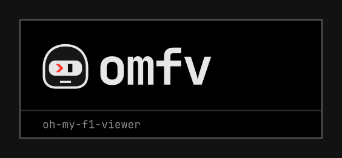
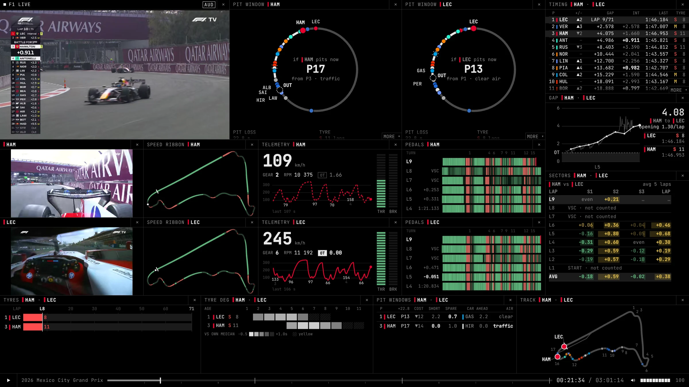
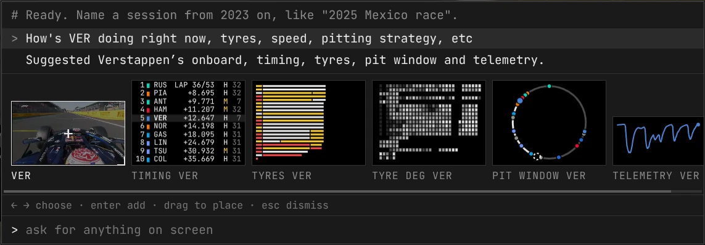
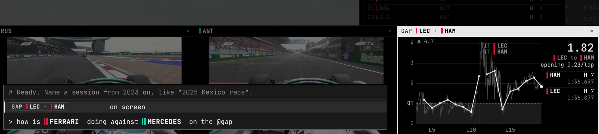
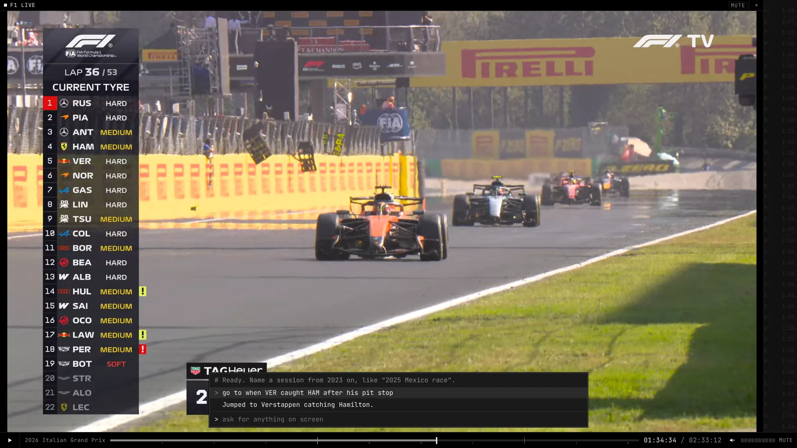
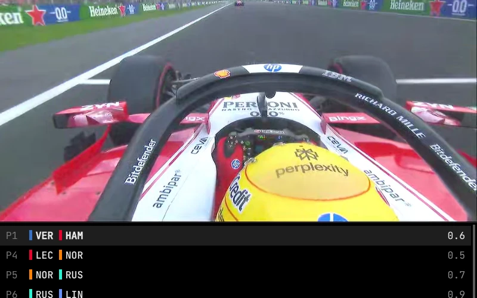
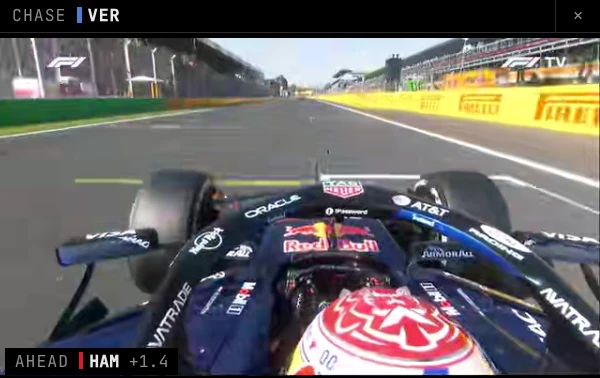
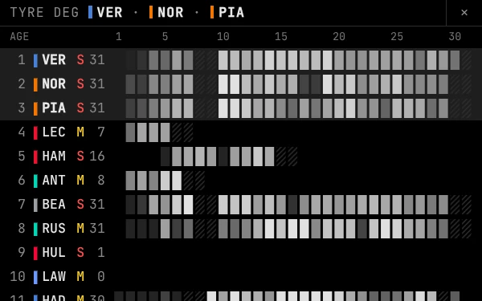
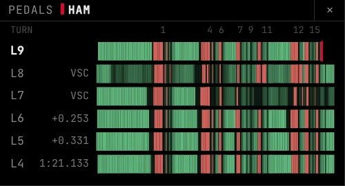
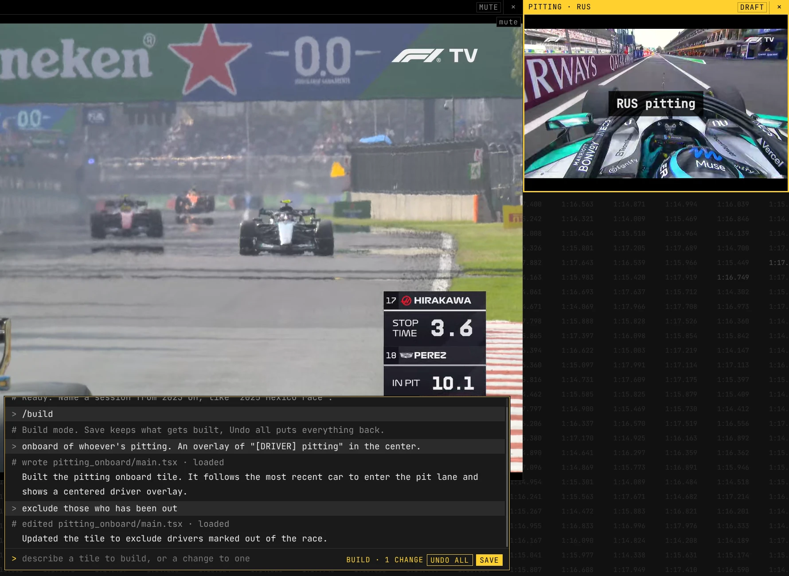

<p align="center"></p>

<p align="center">
  <b>An agent-driven, multi-view F1 TV player.</b><br>
  Tell it what you want to watch, and it opens the session and lays out the onboards and live charts on one clock.
</p>

<p align="center">
  <a href="LICENSE"></a>
  
  
</p>

<p align="center">
  <a href="https://oh-my-f1-viewer.yueyao.run">Website</a> ·
  <a href="#install">Install</a> ·
  <a href="docs/ARCHITECTURE.md">Architecture</a> ·
  <a href="#documentation">Documentation</a>
</p>



> [!NOTE]
> OMFV is in beta. It's an unofficial fan project, not affiliated with Formula 1, and it needs your own F1 TV subscription
> and an LLM provider. Everything runs on your machine: there is no OMFV server.

## Features

- **Ask in plain words.** Name a session, a driver or a battle, and the agent opens it and suggests the tiles to show.
- **Multi-view, in sync.** The race feed, onboards and charts all follow one session clock. Drag, swap and resize tiles, or
  let `/auto-layout` arrange them.
- **No spoilers.** Charts and the agent only see data up to the frame on screen. The agent asks before it looks ahead.
- **Race charts.** Battles, gaps, timing, tyre degradation, pit windows, telemetry and more, built from F1's timing feed.
- **Build mode.** Describe a view that isn't there, and the agent writes it as a [mod](docs/MODS.md) you can keep or undo.
- **Replays and live races.** Any session from 2023 on. Live is in alpha.

## Tell it what to watch

The agent picks the onboards and charts for each request, and you can change them mid-race.

| You say | It suggests |
| --- | --- |
| `battle HAM vs VER` | Onboard HAM · Onboard VER · Gap HAM · VER |
| `follow Norris` | Chase NOR · Car telemetry NOR |
| `who's struggling on their tyres?` | Tyre deg · Tyre strategy |
| `could Leclerc pit now?` | Pit window LEC |

<p align="center"></p>

Type `@` to mention a driver, team or tile, so the agent knows exactly what you mean.

<p align="center"></p>

## Jump anywhere, without spoilers

Ask for a moment, and the agent finds it. It asks first whenever it would read ahead of where you are, and nothing on screen
shows what you haven't reached.

<table>
  <tr>
    <td width="50%"></td>
    <td width="50%"></td>
  </tr>
  <tr>
    <td>Lap 22: <code>go to when VER caught HAM after his pit stop</code>, allowed once.</td>
    <td>Lap 37: Verstappen right behind Hamilton.</td>
  </tr>
</table>

## Charts

Each chart is a component that a tile can show. The agent picks the one that answers your question.

<table>
  <tr>
    <td width="25%" valign="top"><br><b>Battle</b><br><sub>Two onboards from the closest fight on track.</sub></td>
    <td width="25%" valign="top"><br><b>Chase</b><br><sub>One onboard, with the gap to the car ahead.</sub></td>
    <td width="25%" valign="top"><br><b>Gap</b><br><sub>Is the car behind closing, and close enough to attack?</sub></td>
    <td width="25%" valign="top"><br><b>Timing tower</b><br><sub>The running order, with gaps and tyres.</sub></td>
  </tr>
  <tr>
    <td valign="top"><br><b>Speed ribbon</b><br><sub>One lap on the circuit: speed, throttle and brake.</sub></td>
    <td valign="top"><br><b>Tyre deg</b><br><sub>How fast each set of tyres is falling off.</sub></td>
    <td valign="top"><br><b>Pit window</b><br><sub>Where a driver would rejoin if they stopped now.</sub></td>
    <td valign="top"><br><b>Pedal barcode</b><br><sub>Brake and throttle, lap after lap.</sub></td>
  </tr>
</table>

Also: car telemetry, sector table, tyre strategy, race control, race status and track map.

## Build mode

`/build` turns the agent into a builder. Describe a view that isn't there, with no code needed:

```
show whoever's pitting
always show the leader's onboard
buttons to skip a lap
the gap to the car behind, on every onboard
```

It writes a [mod](docs/MODS.md) and runs it on the race you're watching as a draft. **Save** keeps it, and **Undo all**
puts everything back. Mods are plain folders, so you can also write or change one yourself. See
[docs/BUILD_MODE.md](docs/BUILD_MODE.md).

<p align="center"></p>

## Requirements

| | |
| --- | --- |
| **Video and data** | An F1 TV subscription. You sign in with your own account, and F1 TV's access and regional rules apply. |
| **Agent** | A ChatGPT plan (sign in with ChatGPT), or an OpenAI or Anthropic API key. |
| **Platform** | Linux x64, or macOS on Apple silicon. Windows isn't supported yet. |

## Install

Releases have a `.pacman` package for Omarchy and Arch, an AppImage for other Linux, and a `.dmg` for macOS. Download them
from [Releases](https://github.com/natheihei/oh-my-f1-viewer/releases), and see
[docs/RELEASE.md](docs/RELEASE.md#install-it) for how to install each. Until the first app release is out, run it from
source.

On first launch the app walks you through signing in to F1 TV and connecting the agent's model. Then open a session.
`Ctrl+Shift+P` (`Cmd+Shift+P` on macOS) shows or hides the palette.

### Run from source

You need [Node.js](https://nodejs.org) (`brew install node` on macOS). Install the dependencies, then the castLabs Electron
build with Widevine, then start it:

```bash
npm install --allow-git=all
```

```bash
node node_modules/electron/install.js
```

```bash
npm run dev
```

[docs/DEVELOPMENT.md](docs/DEVELOPMENT.md) has the app's commands and the checks that run the real app.

## How it works

OMFV is an Electron app with a React renderer.

- **Playback.** The main process signs in to F1 TV and handles entitlement and the Widevine license. The renderer plays
  every feed and keeps them in sync on one session clock.
- **Session data.** F1's timing feed is read into a local SQLite database. Every row records when it became known, so a
  query only returns what the video has reached.
- **Components.** Each tile shows a component. Charts draw on Canvas 2D through a small kit. Components read and write only
  through the host (`src/host`), and mods use the same interface.
- **Agent.** The agent runs on [pi](https://github.com/earendil-works/pi) with your provider. It gets tools built on the
  host, and a spoiler check sits between it and anything ahead of the playhead.

## Documentation

| Doc | Covers |
| --- | --- |
| [ARCHITECTURE.md](docs/ARCHITECTURE.md) | The layers, the host, charts, streams and sync, layout, the agent, sign-in. Start here |
| [DESIGN.md](docs/DESIGN.md) | Where the design is heading, and its rules |
| [HOST.md](docs/HOST.md) | Every read, query, write and primitive the host offers |
| [COMPONENTS.md](docs/COMPONENTS.md) | How a tile's component behaves, and each chart's decisions |
| [MODS.md](docs/MODS.md) | What a mod is, and how the app loads it |
| [BUILD_MODE.md](docs/BUILD_MODE.md) | `/build`: the build agent, drafts, Save and Undo all |
| [SESSION_DATA.md](docs/SESSION_DATA.md) | The session database, and quirks in F1's data |
| [SPOILER_PREVENTION.md](docs/SPOILER_PREVENTION.md) | Each layer that keeps the race from the viewer |
| [DEVELOPMENT.md](docs/DEVELOPMENT.md) | The app's commands, and the checks |
| [RELEASE.md](docs/RELEASE.md) | Releasing and installing the app and the site |
| [STATUS.md](docs/STATUS.md) | What's verified, known issues, and what's deferred |

## Credits

- [F1 OpenViewer](https://github.com/npanu420/F1OpenViewer) (MIT) by npanu420. OMFV builds on its hard-won F1 TV sign-in,
  entitlement, DRM licensing, playback, stream sync and timing work. It is vendored in `electron/vendor/f1ov` and
  `src/data/vendor`, and `src/data/stream.ts`, `syncEngine.ts` and `timeMap.ts` are ported from it.
- [pi](https://github.com/earendil-works/pi) (MIT) runs the agent. The build agent's output limits and edit matching in
  `electron/agent/extensions/modFiles.ts` are ported from it.

## License and disclaimer

OMFV is released under the [MIT license](LICENSE), which also carries the notices for the code above.

OMFV is unofficial and not affiliated with, endorsed by or connected to Formula 1, F1 TV or the Formula One group of
companies. F1, Formula 1 and F1 TV are their trademarks. OMFV does not bypass anything: you sign in with your own account,
and F1 TV enforces its own access and regional rules.
