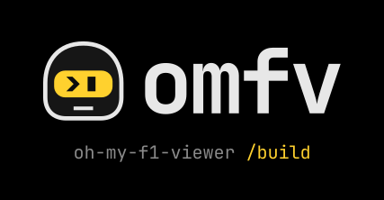

# Build mode

The app's agent normally drives viewing: it finds sessions, suggests tiles and seeks. In build mode it writes mods instead. The viewer
asks to follow something, such as how often NOR opens DRS, the viewing agent finds that no tile shows it and offers to build one, and
on a yes the build agent builds it (2026-11-21). `/build` goes straight there, for a viewer who already knows they want something
built or changed. Onboarding and the site still show `/build` as the way in.

Agreed and built on 2026-11-11. [STATUS.md](STATUS.md) says what's verified. [MODS.md](MODS.md) describes mods themselves, and
[SPOILER_PREVENTION.md](SPOILER_PREVENTION.md) the rules build mode changes.

## The idea

A mod is already a real component: the app compiles it on every save and reloads it while the session plays. So build mode needs no
editor and no separate preview. The draft is the real component, on the open session, and the viewer tries it by using it.

- **The agent chooses what to do.** It creates, edits, forks or deletes folders under `mods/` as the request needs. The viewer never picks
  "add", "edit" or "remove".
- **An installed component is forked, not edited.** Asked to change one, such as the timing tower pointed at with `@`, the agent forks
  it into a new mod and edits that. The fork shows in the strip as a draft, and the installed component and its tiles stay as they
  are. The agent says in a few words that it made a fork, and that the viewer can add it or swap it for the tile they have. See
  "Installed and local" in [MODS.md](MODS.md).
- **The app shows what changed.** It watches the folder and shows the result. The agent doesn't have to announce its work.
- **A build is one transaction.** The viewer ends it with **Save** or **Undo all**.

## Entering and leaving

- `/build` enters build mode, and what the viewer types next goes to the build agent. In the palette's command list it reads "Enter
  build mode", with grey text beside it:
  "! spoiler the agent looks ahead without asking". That text is the viewer's consent to what [Spoilers](#spoilers) describes, and there's no check on entry.
- Entering pauses playback, so the race doesn't run on unwatched while the viewer builds. Leaving doesn't start it again.
- While build mode is on, the palette is yellow: its frame, its prompt, and the tag's text and outlines.
- `/build <request>` also works, entering and sending the request in one line. The command list doesn't mention it.
- While building, a tag beside the input reads `build · 2 changes`, with **Undo all** and **Save** next to it. With no changes yet it's
  a plain `build ×`, and clicking it leaves. The palette stays open, since the tag is the only way out.
- **Save** keeps every change and leaves build mode. **Undo all** puts the mods folder back as it was on entry and leaves build mode.
- Leaving either way offers to go back to the playhead the viewer entered at, since trying a controller moves it: a line in the
  palette such as "back to 0:42:10". It's an offer, and the playhead doesn't move by itself.
- Quitting the app mid-build undoes anything unsaved on the next start, without asking.

With no session open, the command list leaves `/build` out: the build agent checks what it writes against the open session's data
and video. Typed in full, it says to open a session first. The viewing agent can't offer build mode then either, since `offer_build`
is one of the tools it isn't shown until a session is open.

The other `/` commands take no arguments. `/build` is the only one that accepts text after it, and the only one with a warning
beside it.

## What the viewer sees

The app compares the mods folder with how it stood on entry. That one comparison drives everything on screen:

| Change | What happens |
| --- | --- |
| A new mod | Its component appears in the suggestion strip as a live preview, marked "draft". Enter adds it, and dragging places it |
| A new mod, once added to the grid | Its tile is framed with its title bar lit in yellow, as a tile pointed at with `@` is in white, and "draft" is in the title bar |
| An edited mod with a tile on screen | The tile reloads in place, framed and lit the same way, with "edited" in the title bar |
| An edited mod with no tile | It appears in the strip, like a new one |
| A deleted mod | Its tiles leave the screen, as they do today |

A marked tile looks like a tile pointed at with `@` (see Mentions in [DESIGN.md](DESIGN.md)), in build mode's yellow where that one is
white. It doesn't dim the others, and the spotlight still dims it when another tile is pointed at. Pointed at itself, it's white. (2026-11-16. A 1px dashed grey outline round the content and a grey word came
first, which looked nothing like the spotlight.)

The tag's count is the number of mods that differ. The agent's file writes show as lines in the palette's history ("wrote
lap_stepper/main.tsx · loaded", or "· didn't load"), without version numbers.

The comparison follows the folder, not the agent: a file saved by hand during a build counts and shows the same way. The outlines and
marks go when the build ends.

This keeps the rule that the agent suggests tiles and the viewer adds them.

### Props for a draft

- A draft previews with the props the agent suggested it with, or with none, `{}`. A mod declares the props it needs, as the app's
  charts do (see [COMPONENTS.md](COMPONENTS.md)), and never picks a driver itself, so one that needs a driver has no preview until the
  agent suggests it with one. Until then its card in the strip says what it needs, such as "Needs driver". (Before #77 every mod had to draw with `{}`, and one about a pair picked "the closest pair at the
  playhead".)
- When the viewer named drivers ("a duel for Hamilton and Norris"), the agent passes them through `suggest_tiles` in the mod's props,
  `driver_a` and `driver_b` here, and the draft previews with them for the rest of the build. When they didn't, it asks whose.
- A tile that's on screen keeps its props across an edit. If the mod's new `args` no longer accept some of them, it keeps the rest.
  If a required one is then missing, the tile shows an error, "Needs driver", and the view isn't drawn.
- `live.health` says how every tile and every preview in the strip stands. See [HOST.md](HOST.md).

### Attaching a tile's error

A tile that isn't drawing has a button, "Attach error to agent", in both modes. The case it's for is a render error: a mod saves and
draws, then throws at a moment its code didn't expect, such as `gap_ahead` reading the interval of a car in the pit lane. The viewer
watching is the only one who sees that happen. A tile needing props is rarer: a tile can't be added with props that don't fit, so it
only happens when a mod's args change while its tile is on screen, such as a mod edited on disk outside the app.

- The button only attaches: it never sends, and it's never disabled. The tile joins `live.attached` as it stands, replacing what was
  attached for it before, and nothing on the tile changes. The palette opens with a tray above its input, a tag per tile (its label,
  as its title bar names it, and "error at 1:12:40" or what it needs; the tile id is only in what the agent reads), and the viewer is put in the input. × takes one out.
- Enter sends the tray with whatever was typed, or with nothing. While the agent is working, that stops its turn and starts one with
  this message, as any message does. The viewer's line in the history draws each attachment as its tag, as it stood when sent.
- The agent reads each attachment as an `<error>` block of JSON after `app_state`, then the viewer's words: the tile, its label and
  component, its state and message, `missing` and `dropped` for props, `first_threw` (or `since`, for props) with the session clock
  and the playhead in UTC ms, the tile's props, and `log`, the mod's `mod.log`, where the render error's stack is. `errorBlock` in
  `shared/health.ts` writes it, next to `describePlace`.
- The agent works on it on its own. It fixes the tile, or ends its turn with it still broken, the same way or a new one. The tile
  shows what it has then, and the viewer can attach it again.
- In view mode, the viewing agent fixes props with `edit_tile`. A render error is in the code, which it can't change, so it offers
  build mode (below), with the tiles as `error_tiles`.

### Offered from view mode

The viewing agent can't write code, so when something needs it, it offers build mode with `offer_build`, and the viewer decides.
This is the main way into build mode: the viewer says what they want, never that it needs building. The agent offers it for a fix,
which is a tile whose render error is in its component's code, from an attached `<error>` block (#105), and for something to build
(#110).

Whether a request needs a build is decided in the order `VIEW_PROMPT` gives, taking the first that fits:

1. **Something to do on screen now:** a stream, a seek, a tile to remove or change. It does it.
2. **A fact:** a question with one answer as of the playhead, such as "when did HAM last pit". It answers in a line from
   `query_session`. A fact never gets a tile or a build.
3. **Something to follow:** the viewer wants to keep seeing it as the session goes on, such as "track how often NOR opens DRS". It
   needs a tile, and which one is decided in order too:
   - a component covers it, with some props: it suggests that, and never builds a second of what one already shows
   - a component covers it but isn't offered in this session: it says why
   - none covers it and the session's tables hold the data: it offers the build
   - the tables don't hold it, such as tyre temperature: it says so, and offers nothing
4. **Something to keep doing, or a control to press:** "always show the leader's onboard", "buttons to skip a lap". The viewing
   agent acts once per message, so it can't keep it up, but a tile can. A mod defines one component, so this is a tile too, decided
   as in 3. The prompt says nothing can be built that changes the app with no tile on screen, so the agent doesn't offer that.

A request that could be a fact or something to follow, such as "how is HAM's pace", gets a component if one covers it and the fact if
none does, with no offer. The offer comes if the viewer then says that wasn't what they wanted. Asked outright to build or change
something, it offers that, unless a component with other props already does it.

Until 2026-11-21 it offered a build only when the viewer clearly asked for one, and never unasked. The offer is a question the viewer
answers, with the spoiler warning on it, so offering it for what they want to follow costs them one keypress, and saves them knowing
that `/build` exists. **Stay in view mode** tells the viewing agent, in its next `app_state`, what was turned down, and it doesn't
offer that again unless asked.

`offer_build` takes:
- `reason`: what build mode would do, for the viewer, as a few words that start with a verb: "fix the gap chart", "build a chart of
  when NOR opens DRS".
- `note`: the handoff, for the build agent. Its conversation is its own and it sees nothing of the viewing one, so the note says what
  the viewer wants, in their words where they matter, and who or what it is about. The viewer's own words aren't sent along: the note
  carries them.
- `error_tiles`, optional: tiles on screen whose errors go along, for a fix.

It returns at once, and the palette shows the offer where the spoiler check would be: "Build a chart of when NOR opens DRS in build
mode?", the reason with its first letter raised, and under it `/build`'s red "! spoiler the build agent looks ahead without asking", since
entering build mode is that consent. **Switch to build** is in build mode's yellow, beside **Stay in view mode**. The offer goes once
it's answered, or when the viewer sends another message.

Switching enters build mode the way `/build` does, then sends the build agent its first message without the viewer typing: an
`<error>` block for each offered tile, read again from `live.health`, then the note in `<from_viewing_agent>`. A tile that has no error
by then still goes, its block saying so ("It has no error now"), or that it's gone, and the build agent tells the viewer there's nothing
to fix. The palette says "went to the build agent." with the tiles' tags, or "Asked the build agent to build a chart of when NOR opens
DRS." for an offer with none. The tray stays for the viewer's own next message.

`node scripts/offer-check.mjs <out-dir>` checks an offer with no tiles in the app, and with `--agent` the real models: a request a chart
covers gets the chart and no offer, a question gets its answer and no offer, one to follow that nothing covers gets an offer without
the word build in it, and switching starts the build agent on the note.

`node scripts/decide-check.mjs <out-dir> --runs 3 --qualifying` checks the decision itself with the real viewing agent, a new
conversation for each case and each case several times: facts, something to follow that a component covers or none does in several
wordings, a request that could be either and then says which, an offer turned down, something to keep doing, something no tile can
do, data the session lacks, and a race chart asked for in qualifying. It never switches to build mode. All 16 cases passed 3 of 3
on 2026-11-21.

### Trying it

The draft is live, in the strip and on the grid. Its buttons act on the real session: the lap stepper seeks the real playback. It reads
the open session at the playhead, like any tile, so there are no fixtures.

A draft's preview in the strip is wider than a suggestion's, and the mouse inside it belongs to the component. Every preview takes
its shape from the component's `size.aspect`: the card's width is fixed and its height follows, between 98 and 179 pixels for a draft, which is
260 wide, and 78 and 137 for a suggestion, which is 182 wide (`src/shell/stripShape.ts`). The build agent is told to declare `size` on what it builds, to draw no
heading of its own, and to keep what matters most visible in a small tile. A component can still outgrow its tile. Its name underneath is
what adds it, by a click or Enter, or drags it onto the grid.

## Undo all and Save

The main process owns the mods folder, so it keeps the snapshot:

1. **On entry** it copies `mods/` to `mods-snapshot/files` beside it in the app's data folder, and writes a marker file,
   `mods-snapshot/complete`, last. It skips what the app regenerates: `.types`, `mod.error` and `mod.log`. A snapshot
   with no marker is a copy that didn't finish, and is ignored and cleared away.
2. **Save** deletes the snapshot.
3. **Undo all** removes every file the snapshot doesn't have, copies the snapshot's files back, removes the folders the build made, and
   deletes the snapshot, marker last. The mods folder itself stays in place, so the watcher keeps watching it: it sees the changes, and
   reloads or unregisters as it does for any save. A restore that's interrupted runs again on the next start.
4. **On start**, before the watcher starts and before anything is read, a marker means a build didn't finish, and main runs the same
   Undo all.

Quitting, crashing and Undo all share that one path. Anything else that wrote to `mods/` during the build is undone too, such as an
edit made by hand.

## The build agent

Build mode runs as its own agent session, not the viewing one with different tools. Moving between the two changes the tools and the
instructions, and a separate session keeps what the build read out of the viewing conversation.

- **It starts without the viewing conversation.** It gets the usual app state: the session, the playhead and what's on screen, and with
  it what the build has changed so far and every mod there is. That's enough for "make the chart I'm looking at show 12 laps".
- **Its instructions are its own**, `shared/buildPrompt.ts`: how to work, and the mod guide in `shared/modGuide.ts`, which is what a
  mod is, a complete example, the host in brief and the rules for a component. [COMPONENTS.md](COMPONENTS.md) is where those rules are decided.
  The chart and table lists follow them, as for the viewing agent, with each component marked `(installed)` or `(local)`. The event
  list doesn't: it can't find or open a session.
- **It gets file tools for the mods folder.** They run in the main process and reach nothing outside the folder:

  | Tool | What it does |
  | --- | --- |
  | `read`, `ls`, `grep`, `find` | Reads and searches the folder: mods, their `mod.error` and `mod.log`, and the types under `.types` |
  | `write`, `edit` | Writes inside a mod's folder, then waits for the app to load the save and says whether it did, with the error if not. `edit` takes several changes to one file in one call |
  | `fork_component` | Copies a component, installed or a mod, into a new mod with the name, title and tile label it's given (`Mods.fork`), then waits for it to load, like `write` |
  | `delete_path` | Deletes a file in a mod, or a whole mod by its folder name |
  | `mod_status` | Whether the latest save loaded, how each of the mod's tiles and its draft is drawing, and the last lines of its log |
  | `look_at` | A picture of the mod's component as it shows now |

  They refuse the app's own files (`.types`, `mod.error`, `mod.log`) and anything that isn't in a mod's folder. A write under
  `.installed` says it's an installed component's source, and to fork it.
  All of them are the app's own (`electron/agent/extensions/modFiles.ts`), written over `fs` alone, with the descriptions, parameters and result texts pi's tools of those names had. Every path is resolved the way
  pi resolved it (a leading `@` stripped, `~` expanded) and then checked against the mods folder, so a refusal names the path really
  meant. `read` returns any file as text: a picture of a component comes from `look_at`. `edit` matches as pi's does:
  exactly first, then with quotes, dashes and trailing spaces made plain, keeping each line's ending and a BOM. Each piece must
  match once. `find` and `grep` walk the folder themselves, so the app needs no fd or ripgrep, and `grep`'s pattern is a JavaScript
  regular expression. There is no `bash`.
- **It keeps some viewing tools:** `list_streams`, `remove_tiles`, `edit_tile`, `play`, `pause`, `suggest_tiles`, `query_session` and `seek_to`. The
  last two don't ask the spoiler gate. `suggest_tiles` takes any component name here, since the mod may have been written this turn.
- **It can see a picture of a draft**, in the strip or on the grid, to check how it looks. `look_at` records the window with
  Element Capture, restricted to the tile or draft, and keeps the first frame with its shape (`src/host/picture.ts`). The frame's
  scale isn't the window's: Chromium fits a recording to the screen and raises the page's scale while it's recorded, so on macOS a
  tile came 1.18 times its size. The palette floating over a tile isn't in it, and nothing on screen changes while it's taken. That takes each tile and draft being a stacking context of its own
  (`isolation: isolate` in `styles.css`), and the window allowed to record itself: `electron/main.ts` grants `display-capture` to the
  app's own window only, and a recording only of itself. The viewing agent never sees what a chart shows. The build agent may, since
  it can already read the whole session.
- **It hears when something isn't drawing.** A mod that loads may still not draw: its draft needs props nobody gave, a tile's props
  stopped fitting, or the view threw. The report is `live.health`, and the agent gets it three ways, each line saying what would fix it:
  - **A save's result** adds the saved mod's own places that aren't drawing: "pace loaded. Draft pace in the strip: needs driver. Call
    suggest_tiles with it and its props, or ask the user whose."
  - **Before a turn ends**, the app looks at every tile and draft. If something isn't drawing, the agent is told and goes on, so it's
    fixed in the turn that caused it. This is pi's `agent_before_settle`, in `electron/agent/extensions/renderCheck.ts`. It's told only
    of problems it hasn't been told of, and at most twice for one message: some it can't fix alone, such as a draft that needs a driver
    the viewer hasn't named, and then it has to ask.
  - **The next message's `app_state`** has a "not drawing" line for anything that stopped between turns, such as a render error at a lap
    the code didn't expect.

  "Drawn" only means it didn't throw. Whether it looks right still takes `look_at`.
- **It gets more rounds.** A build turn may take 60 rounds of tool calls, where a viewing turn stops at 10. Being sent on to fix
  something counts toward them.
- **On exit, the viewing agent gets one line**, such as "Built lap_stepper, edited lap_form." The app writes it from the folder
  comparison. The model doesn't, so the line can't carry anything the build read. It arrives in the `app_state` of the viewer's next
  message, once. Undo all sends nothing.
- **Each build is stored** as its own `<time>_build.sqlite` in `<userData>/conversations`, beside the picking and viewing conversations'
  `<time>_pick.sqlite` and `<time>_view.sqlite`, for reviewing what the build agent did: `node devscripts/conversation.mjs build`.

## Spoilers

**Build mode has no spoiler check.** The build agent can read the whole session, which it needs: early in a replay there's no data at
the playhead to test a query against.

What protects the viewer instead:

- **Consent on entry:** the warning text on `/build`.
- **Nothing crosses back.** The viewing session never sees the build conversation, only the line the app writes. Leaving build mode
  ends the build conversation, and the next build starts a new one.
- **The prompt.** The build agent is told not to say what it read, as the viewing agent is after an approved read ahead.

What this doesn't cover:

- What the build agent says to the viewer during the build. Only the prompt stops it.
- Race data the agent writes into a mod's source. The prompt tells it not to: a component queries for itself, since the same mod runs on
  other sessions.

## Components that look ahead

A component sometimes needs the future. The lap stepper has to know when the next lap starts, and that lap hasn't happened at the
playhead.

The mod's author decides whether a component warns the viewer:

- **`looksAhead: true` in `defineComponent`** says the component reads or acts on what the viewer hasn't watched.
- **The grid then stands a warning in for the tile**: a red `! spoiler`, "This tile looks ahead of where you are." and an
  **Allow** button. The component's view isn't drawn until the viewer allows it, so none of its queries run before that.
- **`useSql(sql, params, { asOf: 'session' })`** reads the whole session. It doesn't ask anything itself.
- **Nothing enforces the flag.** A component that reads the whole session without it is drawn at once. The build agent's
  instructions say to set it on any component that uses `asOf: 'session'` or could take the viewer past the playhead.
- **Approval belongs to the tile.** It lasts until the tile is destroyed, and another tile of the same mod asks again. It survives a
  hot reload, since the tile is the same tile, so a draft is approved once per build. The app starts with an empty layout, so no
  approval outlasts a restart.
- **The strip preview asks too.** Allowing it there carries over to the tile it becomes.
- **An approved tile says so quietly**: its header carries an "ahead" slot.

An earlier version of this design had `useSql` ask whenever it was given `asOf: 'session'`. The flag replaced it: whether a tile
needs the warning is the author's call, and a tile can act on the future without a query that says so.

A component that acts on the future does it as the agent does: it finds the moment with `useSql` and calls
`host.playback.seekToDate`. The host gets no new writes for this.

`host.data.sql` reads the whole session the same way. See [MODS.md](MODS.md).

## Options we looked at

The mockups are at https://claude.ai/artifact/H4MXaDgaGVvmen5w97ij9v. Boards 4 and 5 show what's described here.

| Option | Why not |
| --- | --- |
| A workbench sheet over the layout | The viewer picks a mod and an operation, and the sheet hides the video a controller acts on |
| The draft as a tile in the grid | The layout moves while the viewer watches, and the agent would add tiles itself |
| A floating draft above the grid | A new kind of surface. It's the next step if strip previews turn out too small |

## Checking it

`node scripts/build-check.mjs <screenshot-dir>` runs these in the real app, on a replay race, through the real palette with the real
agent, like `scripts/mods-check.mjs` and `scripts/seek-check.mjs`. It needs F1 TV signed in, the agent set up and an empty mods folder, which it leaves
empty. Cases 5, 15, 17 and 20 matter most: a broken build would get them wrong without anyone noticing.

It runs in three parts: a build that's saved, a build that's undone, and a build the app is killed in. How it runs a few of the cases:

- **7:** a layout never holds the same component with the same props twice, so it closes the tile and adds the mod again.
- **10:** it breaks the mod's source itself, checks the tile, then asks for an unrelated change. The agent has to fix the break to get
  its own save to load.
- **11 and 12:** it asks for "a new mod called duel", since for a plain battle chart the agent suggests the app's own gap chart.
- **18:** it leaves a snapshot with no marker on disk and starts the app, without timing a kill to land inside the copy.
- **19 and 22:** it checks that no spoiler check showed and that the saved source holds no timestamps or tables of numbers. Whether the
  agent's replies gave anything away is read from its output by a person.

`node scripts/fork-check.mjs <screenshot-dir>` checks forking the same way: the timing tower on screen, `/build`, and a change asked
of its tile pointed at with `@`. The agent should fork it, the fork should load and show in the strip as a draft, the tower's tile
and its installed source should stay as they were, and the reply should say it made a fork.

The unit tests cover the snapshot (`electron/mods/snapshot.test.ts`), forking (`electron/mods/installed.test.ts`), the build conversation and its file tools
(`electron/agent/agent.test.ts`), drafts and approvals (`src/host/build.test.ts`), the build agent's tools (`src/agent/tools.test.ts`)
and `/build` itself (`src/shell/commands.test.ts`).

**Entering**

1. Typing `/b` lists `/build` with "! spoiler the agent looks ahead without asking" beside it, in the hint grey.
2. `/build a controller that can go back and forward laps` shows the `build ×` tag with no spoiler check. The layout is untouched
   and playback pauses.

**A new mod**

3. The palette shows the write and "loaded", with no version number, and the tag becomes `build · 1 change`.
4. The stepper appears in the strip marked "draft", without the agent calling `suggest_tiles`.
5. The agent set `looksAhead` on it, and the preview shows the look-ahead warning. After Allow, clicking "lap ›" moves the real playback to the start of the next lap, by the
   session database.
6. Enter adds it to the grid already approved, its header lit in yellow with "draft" and an "ahead" slot.
7. A second tile of the same mod asks again.

**An edit**

8. "Show the lap number bigger" reloads the tile in place, in the same position and still approved.
9. Editing a mod that's on screen (lap form to 12 laps) frames it with its title bar lit in yellow and "edited", and the tag counts 2 changes.
10. A save that doesn't compile keeps the last good version on screen, and the agent fixes it from `mod.error` unasked.

**Props**

11. "A battle chart for Hamilton and Norris" previews with those two drivers.
12. Added to the grid with those props, it draws something.

**A delete**

13. "Remove the lap stepper" takes its tile off screen, and the tag counts the change.

**Leaving**

14. Save: the tag goes, the mods stay on disk, the snapshot folder is gone and the tiles stay.
15. Undo all: the new mod's folder and tiles are gone, the edited mod is back to its old code on screen, and a deleted one is back.
16. Either way the palette offers "back to 0:42:10", and clicking it returns the playhead there. Not clicking leaves it alone.
17. Quit mid-build and restart: the mods folder matches how it stood on entry, with no prompt.
18. Kill the app during the snapshot copy: the next start ignores the half copy and leaves `mods/` alone.

**Spoilers**

19. During a build at 0:00 of a replay, the agent reads the whole session with no check, and its replies don't mention results.
20. After leaving, the viewing agent's next request, read from its stored conversation, holds only the app's one line.
21. After leaving, "go to lap 30" in view mode asks "The agent wants to look ahead of where you are." again.
22. The saved mod's source has no race data written into it. This is a read of the file, not of the screen.

**The picture**

23. After "give the buttons a 3px white border", the build's stored conversation shows it took a picture of the draft, the turn's
    notes say it looked, and the screen matches.
24. Asked for a mod about one driver with nobody named, the agent hears that its draft needs a driver, the strip's card says so, and
    the agent asks whose without picking.
25. Asked to change a mod on screen from two drivers to one, the agent hears that the tile's props no longer fit, and gives the tile its
    driver in the same turn.
26. A tile that stopped between turns is named in the next message's app state, and the agent fixes its code.

**Video**

27. Asked for a mod with two onboards picked in the tile, the agent holds them with `useStream`, draws them with `<Video stream>`,
    names them in the title bar with `useTileHeader` and `streamSlots`, and keeps the pick with `useTileState`, not props. Its tile
    plays both. `scripts/build-video-check.mjs` runs this case on its own, and Undo all leaves the mods folder as it was.

## Where it lives

| Piece | File |
| --- | --- |
| The snapshot: taking it, restoring it and what differs | `electron/mods/snapshot.ts` |
| Begin, Save, Undo all, the check on start, and waiting for a save to load | `electron/mods/index.ts` |
| The build conversation beside the viewing one | `electron/agent/agent.ts` |
| The build agent's file tools | `electron/agent/extensions/modFiles.ts` |
| Its instructions | `shared/buildPrompt.ts`, `shared/modGuide.ts` |
| What isn't drawing, and how it's said to the agent | `src/host/health.ts`, `shared/health.ts`, `electron/agent/extensions/renderCheck.ts` |
| Its viewing tools, without the gate | `src/agent/tools.ts` |
| Which agent a message goes to, and the line for the viewing agent | `src/agent/bridge.ts` |
| The picture of a draft | `pictureOf` in `electron/ipc.ts` |
| Build state in the host: `live.build` and `host.build` | `src/host/build.ts`, `src/data/build.ts` |
| Drafts in the strip | `src/host/suggestions.ts`, `src/shell/SuggestionStrip.tsx` |
| `asOf: 'session'` | `src/host/useSql.ts` |
| `looksAhead` | `src/host/components.ts` |
| Approval per tile | `src/host/lookAhead.ts` |
| The warning, the outline and the title's "looks ahead" | `src/host/Grid.tsx`, `src/layout/Stage.tsx`, `src/layout/GridSurface.tsx` |
| `/build` and its warning text | `src/shell/commands.ts`, `src/shell/CommandPalette.tsx` |
| Entering, leaving and the offer to go back | `src/shell/buildMode.ts` |
| The tag, Undo all and Save | `src/shell/CommandPalette.tsx` |
